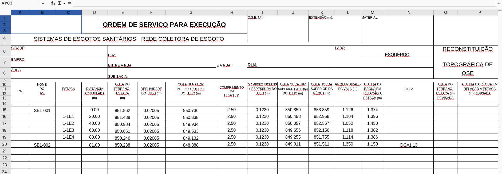

Overview
---
Esse é um programa especifico que desenvolvi para conseguir exportar dados do Sancad (e uma parte da topografia) em um template excel usado pela **Sanepar**.

Ele é feito para funcionar **apenas** no template que vem com esse plugin.

O funcionamento dele é local e foi pensado para funcionar junto com o programa [Flux](https://github.com/itsWilliam-San/Flux).

>[!IMPORTANT]
> Este software é um projeto independente, desenvolvido de forma autônoma por um desenvolvedor independente. Ele **NÃO** é um produto oficial, não possui qualquer vínculo comercial, técnico ou de patrocínio com a Companhia de Saneamento do Paraná (Sanepar), nem com qualquer outra entidade governamental ou corporativa mencionada.

Instalação
---
1. Navegue até a pasta *plugins* do Programa Flux. 
   Para Windows ela está incluida junto com o binário (.exe)
2. Clone o repositório (Ou baixe o .zip e depois descompacta ele na pasta plugins)
    ``` bash
    git clonehttps://github.com/itsWilliam-San/Sancad2Excel.git
    ```
3. Caso o Flux já esteja aberto, atualize a lista de Plugins, ou então apenas feche e abre o programa.

Como usar
---
1. Importe um sistema para dentro do programa [Flux](https://github.com/itsWilliam-San/Flux) via algum plugin de importação.
   Utilize o plugin local [Network-Importer](https://github.com/itsWilliam-San/Network-Importer) caso queira testar ou caso tenha um arquivo de
   sistema em formato `.json`.
2. Digite **em metros** o diametro total da tubulação (espessura + diâmetro interno)
3. Clique no botão de ação.

Os arquivos estarão localizados em uma pasta "output" na mesma pasta que você colocou esse plugin.

Funcionamente
---
O plugin trabalha em cima do template chamado "template.xlsx" que está junto com está pasta, se você abri-lo vera que ele terá os cabeçalhos:

- **RN**: Você encontra-rá campo provavelmente se encontra na planta do projeto que vem da Topografia, no arquivo `.json` ele deve se encontrar
  dentro do campo *psets*, onde terá um objeto de nome *Topo*, por fim deve ter um campo de nome *RN* onde estará escrito o *RN* de um PV ou Terminal
  de limpeza especifico. Esse é o único campo que exige o campo *psets*, o restante pertence a campos nativos esperado pelo Flux.
- **NOME DO PV**: Nome de identificação do PV, devendo ser **único**.
- **ESTACA**: Nome de identificação das estacas intermediarias, deve ser **único**.
- **DISTÂNCIA ACUMULADA (m)**: Esse é calculado por esse plugin e representa a distância acumulada desde o começo do PV até aquele PV (ou Estaca) da linha
    atual em metros.
- **COTA DO TERRENO - ESTACA (m)**: Nível de terreno da estaca ou poço de visita em metros.
- **DECLIVIDADE DO TUBO (m)**: O plugin espera que um segmento (Composto por montante, juntante e estacas) possui a mesma declividade (Como é comum em sistema
  de esgoto), representa a declividade do tubo em metros.
- **COTA GERATRIZ INFERIOR DO TUBO (m)**: Nível da geratriz inferior do tubo em metros.
- **COMPRIMENTO DA CRUZETA**: É determinado pela formula excel a seguir: `=ROUNDUP((L{row}+1)/0.5, 0)*0.5`.
- **DIÂMETRO INTERNO + ESPESSURA DO TUBO (m)**: Esse é fornecido pelo usuário antes da execução do plugin.
- **COTA GERATRIZ SUPERIOR EXTERNA DO TUBO (m)**: A soma do nível da geratriz inferior com a soma do diâmetro interno e a
  espessura do tubo.
- **COTA BORDA SUPERIOR DA RÉGUA (m)**: A soma da geratriz superior externa com o comprimento da cruzeta.
- **PROFUNDIDADE DA VALA (m)**: A subtração da cota do terreno com a cota da geratriz inferior.
- **ALTURA DA RÉGUA EM RELAÇÃO A ESTACA (m)**: A subtraçao do comprimento da cruzeta com a profundidade da vala.
- **OBS**: Caso o tubo não termine no fundo do poço de visita do juntante, aqui é anotada o tipo de "conexão" e a profundidade
  que a geratriz inferior do tubo está em relação ao terreno. Por exemplo, caso a diferença seja pouco e seja utilizado
  um "Degrau de Queda" (Representado como DQ) e a profundiade do nivel de terreno daquele poço de visita com a geratriz de inferior seja de 0.1 metros, o campo ao lado do juntante será escrito como "DQ=0.1"
  
Cada segmento é posto em seu próprio arquivo, o nome do arquivo é o mesmo que o nome de identificação do segmento.
(Isso podem mudar no futuro).



Para Plugins de Exportação
---
Para quem esteja desenvolvendo um plugin de extração que funcione perfeitamente com esse plugin, o único ponto a se atentar
é se os níveis estão em metros (Que é o padrão que o Flux espera para todos os níveis, cotas, etc.) e que tenha o campo
"psets > Topo > RN" como descrito anteriormente, o resto é suportado nativamente pelo Flux.

> [!WARNING]
> Esse Plugin pode mudar e deixar de ter suporte no futuro assim como o Flux vai se desenvolvendo até suas etapas finais.
> Então os campos podem mudar de novo, ou até de comportamento no futuro, então por favor verifique sua versão do
> Flux e desse Plugin para que não tenha problemas.

Problemas Comuns
---
Erro `#VALOR!` ou contagens incorretas
* **Sintoma:** Alguns campos aparecem com o erro `#VALOR!` e as contagens de dados ficam erradas.
* **Causa:** Conflito nas configurações de região e internacionalização (geralmente na leitura de separadores decimais, como vírgula e ponto, ou formatos de data).
* **Solução:** Certifique-se de que o seu programa ou o sistema operacional esteja configurado com o padrão regional dos **Estados Unidos (Inglês - EUA)** para a leitura correta do arquivo.

Nota de Desenvolvimento
---
Esse Plugin está sendo desenvolvido para atender os requisitos especificos de uma empresa *GXH*, logo as regras de exportação podem mudar com o tempo.
E as mudanças será feito apenas para atender os objetivos da empresa, logo requisições para antender outro tipo de demanda **não** serão aceitas nesse repositório,
apenas concertos de bugs serão atendidos.
